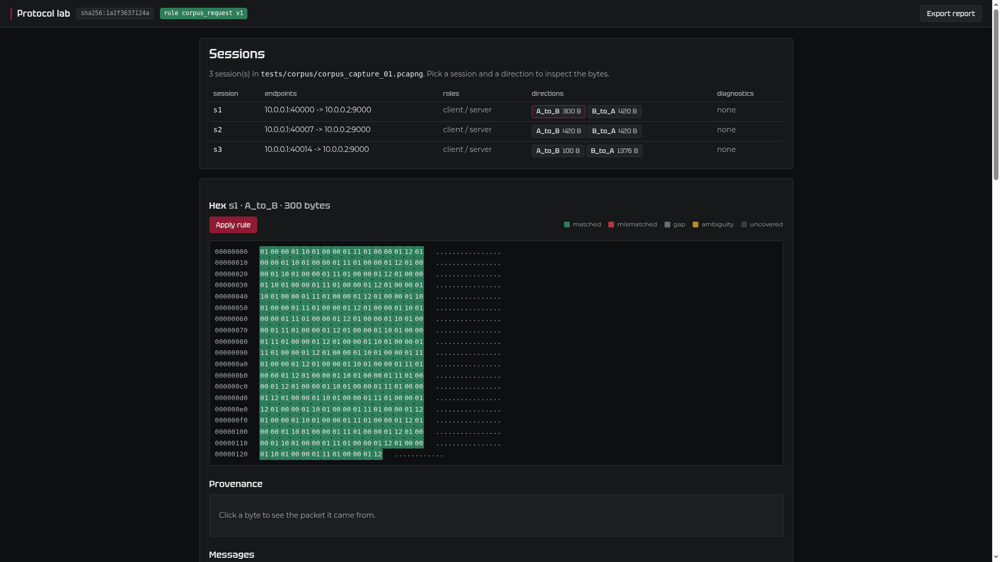

# Веб-интерфейс (необязательно)

Английский оригинал: [WEB.md](../WEB.md).

Небольшая локальная веб-страница поверх тех же движков захвата и правил, что
использует настольное окно. Она необязательна: настольное приложение остаётся
основным интерфейсом, и ничто здесь его не меняет. Веб-слой не добавляет
собственной логики протокола — он оборачивает `src.capture` и `src.protocol` и
отрисовывает результат.

Используйте его, когда хочется посмотреть захват из браузера, на машине, где
PySide6 не установлен, или когда нужна ссылка на одну сессию.

## Установка

Веб-стек — дополнение, поэтому настольная установка остаётся небольшой:

```
pip install -e ".[web]"
```

Это тянет FastAPI, uvicorn, Jinja2 и python-multipart. Базовой установке и GUI
они не нужны.

## Запуск

```
python -m src.web.app --capture out/cap01.json --rule examples/corpus_rule_v1.json --port 8765
```

Затем откройте <http://127.0.0.1:8765>.

- `--capture` принимает нормализованный файл `*.normalized.json` или сырой
  `.pcap`/`.pcapng`, который нормализуется в памяти при открытии.
- `--rule` необязателен. Без него байты всё равно показываются и фреймятся, но ни
  одно сообщение не судится: каждый байт — `uncovered`.
- `--port` по умолчанию `8765`.

Сервер слушает только `127.0.0.1`. Любой другой `--host` отвергается, поэтому
интерфейс нельзя случайно выставить в сеть.

## Снимок



Список сессий связывает каждое направление с hex-просмотром; применение правила
превращает цвета байтов в вердикты, а клик по байту показывает его исходный пакет.

## Проверено

Проверено на слитой `main` (после переписывания README сдачи) на
`tests/corpus/reference_export/corpus_capture_01.normalized.json` с
`examples/corpus_rule_v1.json`: сессии → hex → применение → клик по байту →
провенанс. Все три направления разрешаются, правило сообщает `matched`, а карточка
провенанса показывает пакет 3, seq 1001, ts 1700000000.004 для байта 0. Полный
набор прошёл на 794 тестах на замороженном теге `v1.0.0`; текущая `main`
с тех пор выросла до 957. Запись того прогона — в
[screenshots/verify/web.png](../screenshots/verify/web.png).

Сам веб-модуль во время слияния не менялся; конфликтовал только `README.md`,
потому что `main` переписал его в формат сдачи.

## Что он делает

- Открывает захват и перечисляет его сессии, с конечными точками, ролями и
  диагностиками.
- Выбирает сессию и направление.
- Показывает собранные байты как hex, с подсветкой
  matched/mismatched/gap/ambiguity.
- Применяет правило к направлению и читает вердикты по каждому сообщению.
- По клику на байт показывает его провенанс: индекс пакета, номер
  последовательности TCP и временную метку.
- Читает список сообщений со смещением, длиной, полями и статусом.
- Экспортирует текущую интерпретацию как самодостаточный HTML-отчёт.

Отрисовка — серверный Jinja2 с подменой фрагментов на месте через HTMX. Таблица
стилей и `htmx.min.js` отдаются локально, поэтому странице не нужна сеть.

## Что он не делает

По замыслу и чтобы держать область честной:

- нет редактора правил или сравнения/версионирования правил
- нет метрик, графиков или корреляции с журналом
- нет поиска альтернативных гипотез
- нет переключения темы (одна тёмная тема, брендовая)
- нет учётных записей, сессий, базы данных или персистентности — всё состояние в
  памяти

## Ошибки

Плохой путь, испорченный захват или неизвестная сессия возвращают простую страницу
с причиной, а не трассировку стека:

- неизвестный захват / плохой файл: HTTP 400 с сообщением
- неизвестная сессия или направление: HTTP 404
- смещение вне потока: HTTP 404
- занятый порт: процесс завершается с ясным сообщением в stderr

## Шрифты

Страница использует те же файлы Tektur и Montserrat, что лежат в `assets/fonts/`,
отдаваемые по `/fonts`. Веб-пакет не держит вторую копию.

## Тесты

```
pytest tests/web/ -q
```

Тесты гоняют приложение FastAPI в процессе и запускают настоящие движки на
эталонном корпусе.
